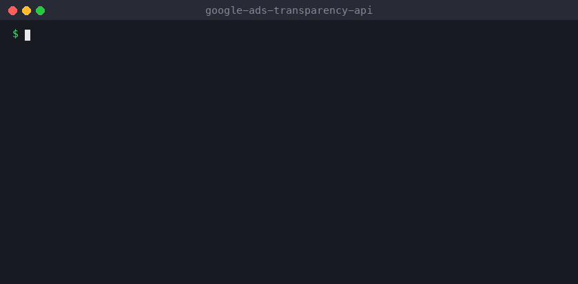

# Google Ads Transparency Center API for Python and JavaScript

See every ad a company runs on Google, from code. It covers Search, YouTube, Shopping, Maps and Play, and works by **domain, advertiser name, advertiser ID or URL**. Data comes from Google's public [Ads Transparency Center](https://adstransparency.google.com).



**Guides:** [How to see a competitor's Google ads (and export to CSV)](docs/see-competitor-google-ads.md) · [Daily alert for new competitor ads](docs/new-competitor-ads-alert.md)

```python
from google_ads_transparency import GoogleAdsTransparency, to_dataframe

gat = GoogleAdsTransparency()   # reads APIFY_TOKEN
ads = gat.search("shopify.com", region="US", format="video", last_days=30, ad_text=True)
to_dataframe(ads)[["format", "daysShown", "headline", "landingUrl", "videoUrl"]]
```
```
  format  daysShown                         headline                     landingUrl                                     videoUrl
0  VIDEO         29             Start for free today  https://shopify.com/free-trial  https://www.youtube.com/watch?v=4wp8GXAghHo
1  VIDEO         29  Build your store with AI on ...  https://shopify.com/free-trial  https://www.youtube.com/watch?v=42mQXwapqAM
2  VIDEO         29  Sell online, in store, every...  https://shopify.com/free-trial  https://www.youtube.com/watch?v=_dAwN16eOk8
```

Or from the command line, straight to a spreadsheet:
```bash
python -m google_ads_transparency nike.com adidas.com --region US --last-days 30 --ad-text --csv ads.csv
```

## What you get per ad
- advertiser name and ID, format (text, image, video), first and last shown dates, days running
- a preview image and a link to the ad in the Transparency Center
- **with `ad_text=True`:** headline, long headline, description, display URL, landing page, and for YouTube ads the video link, duration and channel
- **with `details=True`:** every country the ad ran in, with dates, and impression ranges per country and platform where Google publishes them (mainly ads shown in the EU)

**Filters:**
- country (`region`)
- `format`
- `platform`: `search`, `youtube`, `shopping`, `maps`, `play`
- `last_days`, or `start_date` / `end_date`
- `max_ads` per search

## How it works, and what it costs
Google has no API for the Ads Transparency Center. Scripts that call its website directly work for a few lookups, then get rate-limited.

This library sends each call to a hosted scraper, [Google Ads Transparency Scraper on Apify](https://apify.com/seodatalab/google-ads-transparency-scraper). The scraper handles requests, retries and fresh IPs, and fetches ad details in parallel.

**You need a free Apify account and its API token:**
1. Sign up at [apify.com](https://apify.com).
2. Copy the token from *Settings → API & Integrations*.
3. Run `export APIFY_TOKEN=...`.

**Pricing is pay-per-result:**
- **$1.50 per 1,000 ads**
- **+$2 per 1,000** with `details`
- **+$1.50 per 1,000** with `ad_text`, charged only when copy is found
- a small fixed fee per call

For example, 1,000 ads with everything turned on costs about $5. Searches that fail cost nothing, and Apify's free plan includes monthly credit.

*Disclosure: the maintainer of this repo also publishes that scraper. The client code is MIT, and you can point it at another actor with the same input using `actor=`.*

## Install
```bash
pip install "google-ads-transparency-api @ git+https://github.com/carterprice2/google-ads-transparency-api"
```
The client has no dependencies. Install `pandas` if you want `to_dataframe()`.

For JavaScript (Node 18+), copy [`js/index.mjs`](js/index.mjs). It's a single file with no dependencies.

## Python
```python
ads = gat.search(
    ["nike.com", "Shopify", "AR16735076323512287233"],  # domains, names, IDs or Transparency Center URLs
    region="GB", platform="youtube", last_days=90,
    max_ads=500, details=True, ad_text=True,
)
```
- **Searching by name** (`"Shopify"`) matches whole words and picks the matching advertiser with the most ads. Big brands often run several advertiser accounts, so use `advertisers_per_name=3` to cover more of them, or search the website domain to get all of them.
- **One call, many searches.** Put all your competitors in one call. It's faster and cheaper than one call per company.
- **Failed searches**, such as a misspelled name, are dropped with a warning and aren't charged. Pass `include_errors=True` to keep them as rows. A `TransparencyError` is raised only if every search fails.
- **`flatten(ad)`** gives one flat dict per ad for CSV. **`to_dataframe(ads)`** gives a pandas DataFrame.

## JavaScript
```js
import { GoogleAdsTransparency, flatten } from './index.mjs';

const gat = new GoogleAdsTransparency({ token: process.env.APIFY_TOKEN });
const ads = await gat.search(['nike.com'], { region: 'US', lastDays: 30, adText: true });
console.table(ads.map(flatten).map(({ format, headline, landingUrl }) => ({ format, headline, landingUrl })));
```

## Use with AI agents (MCP)
The same scraper works as a tool for Claude, Cursor and other MCP clients through Apify's MCP server:
```
https://mcp.apify.com?tools=seodatalab/google-ads-transparency-scraper
```
Then ask, for example: "Which YouTube ads has shopify.com run in the UK in the last 60 days, and where do they link?"

## Output
A real ad, shortened. Empty fields are left out.
```json
{
  "search": "shopify.com",
  "advertiserId": "AR01625195283841286145",
  "advertiserName": "Shopify Inc.",
  "creativeId": "CR14579309272736202753",
  "format": "VIDEO",
  "firstShown": "2026-10-06T15:38:46.000Z",
  "lastShown": "2026-11-03T16:57:15.000Z",
  "daysShown": 29,
  "adUrl": "https://adstransparency.google.com/advertiser/AR01625195283841286145/creative/CR14579309272736202753?region=US",
  "adText": {
    "headline": "Start for free today",
    "longHeadline": "Build your store, manage sales, and start selling with Shopify’s mobile app.",
    "description": "Sell online and in person, manage products, and run marketing from your phone.",
    "displayUrl": "shopify.com",
    "landingUrl": "https://shopify.com/free-trial",
    "videoUrl": "https://www.youtube.com/watch?v=4wp8GXAghHo",
    "videoDuration": "1:00",
    "channelName": "Shopify"
  },
  "details": { "regions": [{ "region": "US", "regionName": "United States", "lastShown": "2026-11-03" }], "variationCount": 5 }
}
```

## Recipes
- **What are my competitors running right now?** Use `gat.search([...competitor domains], last_days=7, ad_text=True)`.
- **Find their winning ads.** Sort by `daysShown`. Advertisers keep ads that perform, so long-running ads are usually the winners.
- **Daily new-ad alerts.** Run on a schedule with `last_days=1` and compare `creativeId`s with yesterday's run.
- **YouTube creative research.** Use `format="video", platform="youtube", ad_text=True` to get video links, durations and headlines in your niche.
- **Market entry.** Use `details=True` to see which countries a brand advertises in.

See [`examples/`](examples).

## FAQ
**Is there an official Google Ads Transparency API?**
No. Google publishes the Transparency Center website, and a BigQuery public dataset that suits bulk SQL analysis if you use Google Cloud. This library is for looking up specific companies on demand from Python or JavaScript.

**Is this allowed?**
It reads the same public pages anyone can open without logging in. Google publishes this data so people can see who is advertising.

**Does it include ad spend?**
No. Google doesn't publish spend for commercial ads. It publishes impression ranges, mainly for ads shown in the EU.

**Why is the ad copy sometimes missing?**
Google archives many search text ads only as images. For those you get `imageUrl` instead of text, and the ad copy isn't charged.

## Development
```bash
python -m pytest tests        # offline, uses a recorded real response
cd js && npm test
```

MIT licensed.
