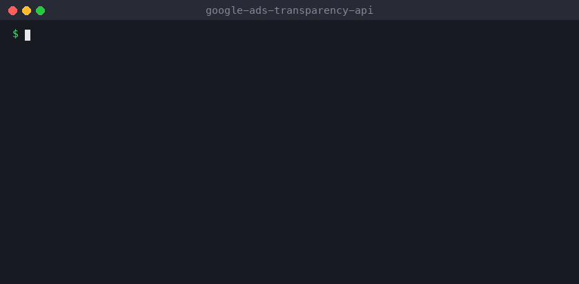

# How to see a competitor's Google ads (and export them to CSV)

Google publishes almost every ad it runs in the [Ads Transparency Center](https://adstransparency.google.com). That covers Search, YouTube, Shopping, Maps and Play. You can see any advertiser's ads there, for free, without logging in.

This guide shows two ways: by hand for a quick look, and from code when you want a spreadsheet, many competitors, or a daily check.



## 1. By hand (free, 2 minutes)
1. Open [adstransparency.google.com](https://adstransparency.google.com).
2. Type the competitor's **website domain** (e.g. `hubspot.com`) or the company name.
3. Use the filters at the top: country, platform (YouTube, Search...), format and date range.
4. Click an ad to see its variations, where it ran and, for ads shown in the EU, impression ranges.

**Limits:**
- You can't export.
- Ad copy is buried inside each ad's preview.
- Checking ten competitors every week means a lot of clicking.

## 2. From Python, into a spreadsheet
```bash
pip install "google-ads-transparency-api[pandas] @ git+https://github.com/carterprice2/google-ads-transparency-api"
export APIFY_TOKEN=...   # free account at apify.com, then Settings → API & Integrations
```
```python
from google_ads_transparency import GoogleAdsTransparency, to_dataframe

ads = GoogleAdsTransparency().search(
    "hubspot.com", region="US", format="video", last_days=30, max_ads=5, ad_text=True)
print(to_dataframe(ads)[["daysShown", "headline", "landingUrl"]].to_string())
```
Real output from 2026-11-04:
```
   daysShown                                headline                         landingUrl
0        128  Know your customers. Close more deals.  https://www.hubspot.com/crm/e010a
1        130     Follow up faster. Close more deals.  https://www.hubspot.com/crm/e010a
2        130  More leads. More deals. One Smart CRM.  https://www.hubspot.com/crm/e010a
3        128     Follow up faster. Close more deals.  https://www.hubspot.com/crm/e010a
4        260                       HubSpot Smart CRM  https://www.hubspot.com/crm/e010a
```
One message ("Close more deals"), tested in several variants and running for months, all sending traffic to one CRM landing page. That's the kind of thing you learn in five seconds here.

**Or skip the code** and write a CSV from the terminal:
```bash
python -m google_ads_transparency hubspot.com salesforce.com pipedrive.com \
    --region US --last-days 30 --ad-text --csv crm_ads.csv
```

## What to look for
- **Long-running ads are the winners.** Advertisers stop ads that don't pay off, so sort by `daysShown`.
- **Repeated headlines** show the message they're betting on. Count the headlines or the first words.
- **Landing pages** (`landingUrl`) show which offer they're pushing: a free trial, a demo or a pricing page.
- **Formats and platforms.** A shift toward video or YouTube shows up within weeks.
- **Countries.** `details=True` lists every country an ad ran in, which hints at market expansion.

## Things to know
- **Text ads:** Google archives many search text ads as images, so you get `imageUrl` instead of text. Video ads and local/Maps ads usually come with full copy.
- **Spend:** Google doesn't publish spend for commercial ads. Impression ranges exist mainly for ads shown in the EU.
- **Name searches:** big brands run several advertiser accounts. A domain search covers all of them, while a name search picks the largest (raise `advertisers_per_name` for more).

## Cost
- $1.50 per 1,000 ads.
- +$1.50 per 1,000 for ad copy, charged only when copy is found.
- +$2 per 1,000 for countries and impressions.
- A small fee per run.

The example above cost about 2.5 cents. Searches that find nothing are free.

Next: [get an alert when a competitor launches new ads](new-competitor-ads-alert.md).

*Disclosure: I maintain this library and the Apify scraper it calls.*
